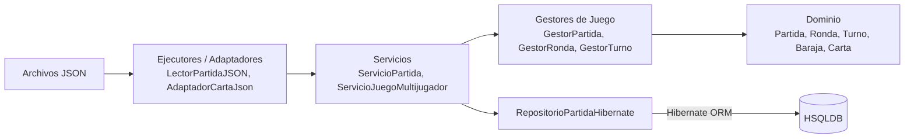

<div align="center">

# 🃏 La Escoba — Motor de Juego y Persistencia en Java

**Implementación completa de la lógica del juego de cartas La Escoba (baraja española de 40 cartas) desarrollada bajo metodología TDD, con soporte multijugador, persistencia relacional en Hibernate y control de calidad continuo.**


</div>

---

## Tabla de contenidos

- [Descripción](#descripción)
- [Funcionalidades](#funcionalidades)
- [Arquitectura](#arquitectura)
- [Testing y calidad de software](#testing-y-calidad-de-software)
- [Refactorizaciones aplicadas](#refactorizaciones-aplicadas)
- [Tecnologías](#tecnologías)
- [Estructura del proyecto](#estructura-del-proyecto)
- [Instalación y ejecución](#instalación-y-ejecución)
- [Autoras](#autoras)

---

## Descripción

Proyecto desarrollado siguiendo **Test-Driven Development (TDD)** en tres iteraciones incrementales para modelar el juego tradicional de **La Escoba** con baraja española de 40 cartas. El sistema separa estrictamente la lógica de dominio, la coordinación de partidas multijugador y la persistencia en base de datos relacional.

Proyecto desarrollado en equipo para la asignatura **Tecnologías para el Desarrollo de Software (TDS)** del Grado en Ingeniería Informática en la Universidad de Valladolid (UVa).

## Funcionalidades

- **Motor de reglas completo:** Gestión de baraja española de 40 cartas, repartos, validación de capturas (suma 15), detección de escobas y cálculo automático de puntuaciones finales (escobas, cartas, oros, sietes y *guindis*).
- **Gestión jerárquica de partidas:** Trazabilidad completa del histórico mediante la estructura `Partida` → `Ronda` → `Turno` → `Jugada` y generación de resúmenes (`ResumenPartida`).
- **Modo multijugador:** Creación y listado de salas, sincronización de turnos y validación defensiva frente a jugadas inválidas recibidas del rival.
- **Persistencia relacional:** Almacenamiento y recuperación de partidas completas mediante **Hibernate** sobre **HSQLDB**, desacoplado a través del patrón **Repository**.
- **Carga y reproducción desde JSON:** Lectura, adaptación y ejecución automatizada de partidas pregrabadas (`LectorPartidaJSON` y `EjecutarPartida`).

## Arquitectura

El sistema sigue principios **SOLID** y desacopla la lógica de negocio de la persistencia y las comunicaciones externas mediante interfaces y adaptadores:



- **Dominio (`uva.tds.entidades`):** Entidades puras (`Carta`, `Palo`, `Baraja`, `Jugador`, `Mano`, `Partida`, `Ronda`, `Turno`, `Jugada`, `ResumenPartida`) y adaptadores de estado.
- **Servicios (`uva.tds.servicios`):** Reglas de juego (`GestorPartida`, `GestorRonda`, `GestorTurno`), validación y estadísticas (`ServicioPartida`), coordinación de salas (`ServicioJuegoMultijugador`) e implementación de persistencia (`RepositorioPartidaHibernate`).
- **Interfaces (`uva.tds.interfaces`):** Contratos `RepositorioPartida` y `ServicioMultijugador` para permitir pruebas en aislamiento mediante *mocks*.
- **Ejecutores (`uva.tds.ejecutores`):** Parseo y simulación de partidas desde ficheros JSON.

## Testing y calidad de software

El proyecto se ha construido bajo **TDD** con distintas capas de verificación y análisis estático continuo:

| Tipo de prueba / herramienta | Alcance y herramientas |
|---|---|
| **Tests unitarios de dominio** | Validación de reglas de baraja, cartas, capturas y flujo de turnos (`JUnit 5`) |
| **Tests en aislamiento** | Verificación de `ServicioPartida` y `ServicioJuegoMultijugador` desacoplados con *mocks* |
| **Tests de integración con BD** | Pruebas sobre `RepositorioPartidaHibernate` con carga de datasets XML (`DBUnit` + `HSQLDB`) |
| **Cobertura y análisis estático** | Informes de cobertura con `JaCoCo` (etiqueta `@Tag("Cobertura")`), análisis con `SonarQube` y pipeline en `GitLab CI/CD` |

## Refactorizaciones aplicadas

Siguiendo el catálogo de **Martin Fowler**, se aplicaron mejoras estructurales sobre el código base:

- **Replace Array with Objects:** Sustitución de estructuras multidimensionales complejas en `Partida` por entidades explícitas (`Ronda`, `Turno`, `Jugada`).
- **Replace Error Code with Exception:** Sustitución de retornos booleanos en las validaciones de `ServicioPartida` por excepciones específicas de dominio.
- **Extract Method:** Reducción de la complejidad ciclomática en el cálculo de estadísticas (`obtenerEstadisticaJugador`).
- **Dead Code Elimination & Duplicated Code:** Eliminación de código muerto y consolidación de casos de prueba duplicados tras el análisis de **SonarQube**.

## Tecnologías

| Capa | Tecnologías |
|---|---|
| Lenguaje | Java 17+ |
| Persistencia | Hibernate ORM, HSQLDB |
| Testing | JUnit 5, Mocks, DBUnit |
| Calidad y CI/CD | JaCoCo, SonarQube, GitLab CI/CD |
| Build y control de versiones | Maven, Git |

## Estructura del proyecto

```text
la-escoba-java/
├── src/
│   ├── main/java/uva/tds/
│   │   ├── ejecutores/     # Lectura y ejecución de partidas desde JSON
│   │   ├── entidades/      # Modelo de dominio (Baraja, Carta, Partida, Ronda, Turno...)
│   │   ├── interfaces/     # Contratos de Repositorio y Servicio Multijugador
│   │   └── servicios/      # Lógica de juego, multijugador e implementación Hibernate
│   └── test/
│       ├── java/uva/tds/   # Tests unitarios, en aislamiento y de integración (DBUnit)
│       └── resources/      # Datasets XML (dataset-partidas.xml) y partidas JSON
├── pom.xml
└── README.md
```

## Instalación y ejecución

### Requisitos

- JDK 17 o superior
- Maven 3.8 o superior

### Pasos

1. **Clona el repositorio**

   ```bash
   git clone https://github.com/TU-USUARIO/la-escoba-java.git
   cd la-escoba-java
   ```

2. **Compila y ejecuta toda la suite de tests**

   ```bash
   mvn test
   ```

3. **Ejecuta la verificación completa con informe de cobertura JaCoCo**

   ```bash
   mvn verify
   ```

## Autoras

Proyecto desarrollado por:

- **Elisa Martínez Lafuente** · [LinkedIn](https://www.linkedin.com/in/TU-PERFIL)
- **Marta Pérez Alonso**

---

<sub>Proyecto académico · Grado en Ingeniería Informática · Universidad de Valladolid</sub>